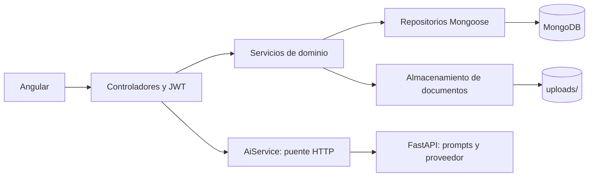

# 00 — Arquitectura y configuración

[Volver al índice](README.md)

El proyecto usa NestJS modular, Mongoose, Passport JWT y DTOs con `class-validator`.
[package.json](../package.json) y `package-lock.json` definen dependencias y resolución.

## Composición

[AppModule](../src/app.module.ts) instala configuración global, conexión MongoDB y archivos
estáticos, e importa `AuthModule`, `NotesModule`, `SpacesModule`, `AssetsModule` y `AiModule`.
Los controladores traducen HTTP; los servicios coordinan reglas; los repositorios mantienen
filtros de propietario y acceso a datos.

[main.ts](../src/main.ts) crea `uploads/`, configura CORS y `ValidationPipe`, instala parsers
JSON/urlencoded y abre el puerto. IA usa 1 MiB de JSON; las demás rutas conservan `100mb`.
Ver [puente de IA](06-PUENTE-DE-IA.md) para el orden de los parsers. Ese límite HTTP no es el límite BSON de MongoDB;
los documentos especializados se guardan en archivos para evitar incluir toda su carga allí.

## Variables

`ConfigModule` lee `.env.local` y `.env` desde el directorio de ejecución, en ese orden.

| Variable | Uso efectivo |
| --- | --- |
| `PORT` | Puerto HTTP, por defecto `3000`. |
| `MONGODB_URI` | Conexión Mongo; por defecto `mongodb://127.0.0.1:27017/weave_db`. |
| `JWT_SECRET` | Firma y validación de tokens. Configurarlo explícitamente. |
| `AI_SERVICE_URL` | URL interna de FastAPI, normalmente `http://127.0.0.1:8000`. |
| `AI_SERVICE_TOKEN` | Secreto compartido con FastAPI, diferente del JWT. |
| `AI_SERVICE_TIMEOUT_MS` | Timeout del puente, por defecto 90 000 ms. |
| `ALLOWED_ORIGINS` | Lista leída por CORS; revisar el comportamiento del capítulo 02. |

`JWT_EXPIRES_IN`, `UPLOAD_DIR` y `MAX_FILE_SIZE_MB` aparecen en el ejemplo histórico, pero no
controlan actualmente esos valores: JWT se configura con `7d`, el directorio se calcula como
`uploads/` y Multer usa 50 MiB. No afirmar que cambiar esas variables cambia el comportamiento.

## Comandos

| Comando | Resultado |
| --- | --- |
| `npm ci` | Instala desde el lockfile. |
| `npm run start:dev` | Compila y observa cambios. |
| `npm run build` | Genera `dist/`. |
| `npm run start:prod` | Ejecuta `dist/main`. |
| `npm test -- --runInBand` | Suite Jest. |
| `npm run lint` | Comprobaciones Oxlint declaradas por el proyecto. |

Los cambios de `.env` requieren reiniciar el proceso. NestJS no debe leer el `.env` de IA ni
importar implementaciones Python; la integración es exclusivamente por contrato HTTP.
