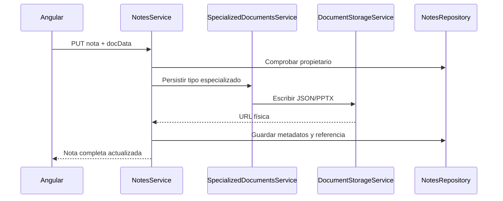

# 04 — Documentos y archivos

[Volver al índice](README.md)

## Responsabilidades

| Servicio | Función |
| --- | --- |
| `NotesService` | Identidad, propiedad, metadatos y coordinación. |
| `SpecializedDocumentsService` | Datos iniciales, conversión y ciclo de vida por tipo. |
| `DocumentStorageService` | Lectura/escritura/borrado físico mediante `fs.promises`. |

Los archivos se ubican en `uploads/documents/`, calculado respecto al directorio de ejecución:

| Tipo | Formato físico |
| --- | --- |
| `sheet`, `doc`, `canvas` | `<noteId>_<docType>.json` |
| `slide` | `<noteId>.pptx` binario |

Las rutas públicas correspondientes se guardan en `docUrl`. MongoDB mantiene la nota y los
bloques; para documentos especializados, el servicio conserva `docData` fuera de la base y
lo incorpora al responder lecturas completas.

## Flujo de guardado

Los PPTX se reciben como `{ format: 'pptx', base64 }`, se decodifican a bytes y se vuelven
a codificar para una lectura completa. Ese coste no debe ejecutarse para cada fila de la
navegación; la vista `summary` evita esas lecturas.

## API específica

`SpecializedDocumentsController` expone `GET` y `PUT /api/notes/:id/document`. Ambos comprueban
propiedad mediante el repositorio. El PUT recibe `docData`; la respuesta contiene identificador,
tipo, URL y datos especializados. Las actualizaciones habituales del frontend también pueden
usar `PUT /api/notes/:id`.

## Operación

Respaldar MongoDB y `uploads/` juntos. La base sin archivos no basta para recuperar documentos
especializados. En contenedores, montar un volumen persistente y no iniciar varias réplicas
con discos locales independientes si deben compartir las mismas notas.

El almacenamiento actual registra fallos y puede devolver `''` o `null`; no hay una transacción
única que abarque MongoDB y disco. Ante errores de guardado, comprobar permisos, espacio y logs,
además de la respuesta de la API. No interpretar una URL o registro Mongo como prueba de que
el archivo se escribió correctamente en todos los casos.
