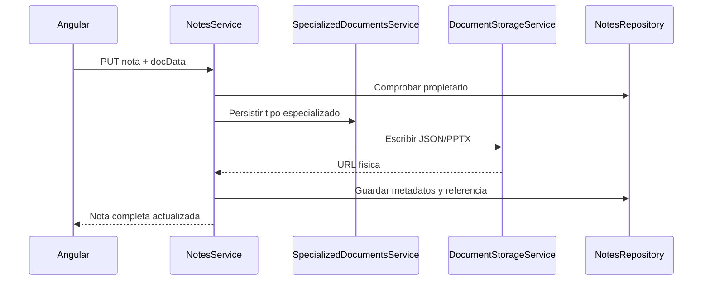

# 04 — Documentos y archivos

[Volver al índice](README.md)

## Responsabilidades

| Servicio | Función |
| --- | --- |
| `NotesService` | Identidad, propiedad, metadatos y coordinación. |
| `SpecializedDocumentsService` | Datos iniciales, conversión y ciclo de vida por tipo. |
| `DocumentStorageService` | Lectura/escritura/borrado físico mediante `fs.promises`. |

Los archivos se ubican en `uploads/documents/`, calculado respecto al directorio de ejecución:

| Tipo | Formato físico |
| --- | --- |
| `sheet` | `<noteId>_sheet.json`: JSON compacto o contenedor comprimido versionado |
| `doc`, `canvas` | `<noteId>_<docType>.json` |
| `slide` | `<noteId>.pptx` binario |

Las rutas públicas correspondientes se guardan en `docUrl`. MongoDB mantiene la nota y los
bloques; para documentos especializados, el servicio conserva `docData` fuera de la base y
lo incorpora al responder lecturas completas.

## Flujo de guardado



Los PPTX se reciben como `{ format: 'pptx', base64 }`, se decodifican a bytes y se vuelven
a codificar para una lectura completa. Ese coste no debe ejecutarse para cada fila de la
navegación; la vista `summary` evita esas lecturas.

## Almacenamiento compacto de hojas

`sheet-storage-codec.ts` conserva el modelo editable completo y optimiza únicamente su representación
física. No se eliminan celdas vacías, formatos, fórmulas, gráficos, dibujos, nombres, tablas ni campos
futuros/desconocidos. Los estilos se guardan una vez y las celdas los referencian mediante una tabla
privada de índices, separada de los datos originales para no colisionar con campos de usuario.
Al leer, cada celda recupera un objeto de estilo independiente.

El archivo sigue siendo JSON válido y conserva su nombre/URL. El contenedor usa
`format: "weave-sheet-storage"`, `version: 1`, `encoding: "gzip-base64"`, longitud descomprimida,
SHA-256 del documento nativo canónico y payload gzip en base64. La compresión es interna al archivo;
no es `Content-Encoding: gzip` HTTP. Si el contenedor no reduce el tamaño, se guarda JSON nativo
compacto. Los JSON antiguos siguen siendo legibles. La API devuelve el libro nativo, no el contenedor;
un consumidor directo de la URL física debe conocer esta versión de almacenamiento.

Cada guardado verifica la igualdad semántica del recorrido antes de publicarlo. La lectura valida
versión, longitud, checksum e índices de estilo, con límite de 128 MiB para contenido expandido.
Una hoja dañada no se devuelve como documento ausente, para evitar sobrescribirla con datos iniciales.
Si hay una copia R2 válida, se puede recuperar desde ella y escribir la caché validada.

Los guardados de un mismo documento se ordenan y capturan una instantánea al recibirse. La escritura
local usa un temporal completo, `fsync` y renombrado atómico. Un fallo conserva el archivo anterior;
si no se pudo guardar ni en disco ni en R2, el guardado falla en lugar de simular éxito.

### Archivos existentes

Compilar y desplegar primero el lector nuevo en todos los procesos del backend. Los documentos
existentes se optimizan en su siguiente guardado normal. Para migrarlos explícitamente:

```sh
npm run build
npm run storage:optimize-sheets -- --dry-run
# Detener los escritores y confirmar que los lectores nuevos están instalados antes de escribir:
npm run storage:optimize-sheets -- --write --offline --readers-ready
```

La migración verifica el documento reconstruido, crea un respaldo gzip de los bytes originales
fuera de `uploads/`, comprueba ese respaldo y rechaza instantáneas que hayan cambiado durante la
operación. Publica mediante renombrado atómico y vuelve a verificar el resultado. Es idempotente;
los libros ya optimizados no se duplican. `--file <noteId>_sheet.json` limita la operación a un libro;
`--directory` y `--backup-dir` permiten elegir origen y destino de respaldos. Detener los escritores
es necesario: la comprobación de cambios no sustituye un bloqueo compartido entre procesos.
Los respaldos están en `backups/sheet-storage/`, excluidos de Git y fuera de las rutas públicas.
La migración local no sincroniza R2; el siguiente guardado normal aplica el formato nuevo a ambas copias.
No hacer rollback a un backend antiguo después de escribir contenedores nuevos sin restaurar antes
las copias JSON originales y verificar que no se descartan cambios posteriores.

Verificación:

```sh
npm test -- --runInBand --runTestsByPath \
  src/modules/notes/services/sheet-storage-codec.spec.ts \
  src/modules/notes/services/document-storage.service.spec.ts \
  src/modules/notes/services/notes.service.spec.ts
npm run test:storage-migration
```

## API específica

`SpecializedDocumentsController` expone `GET` y `PUT /api/notes/:id/document`. Ambos comprueban
propiedad mediante el repositorio. El PUT recibe `docData`; la respuesta contiene identificador,
tipo, URL y datos especializados. Las actualizaciones habituales del frontend también pueden
usar `PUT /api/notes/:id`.

## Operación y Almacenamiento en la Nube (Cloudflare R2)

Para entornos sin estado o en la nube (como Koyeb, Render o Docker efímero), el backend soporta persistencia directa en **Cloudflare R2** mediante el cliente compatible con S3 (`@aws-sdk/client-s3`).

### Entrega de archivos locales

`UploadsFallbackController` comprueba y entrega primero el archivo local mediante `sendFile`,
tanto en `/uploads/:filename` como en `/uploads/documents/:filename`. Las rutas de controladores
pueden ejecutarse antes de `ServeStaticModule`: no se debe responder 404 ni redirigir sin intentar
esta entrega, aunque el archivo exista. Solo un archivo ausente (404/ENOENT) usa el respaldo R2;
los errores de acceso no redirigen y los nombres con rutas, traversal o archivos ocultos se rechazan.
Las respuestas locales conservan MIME, rangos y cabeceras estándar de Express.

### Variables de entorno
```env
R2_ACCOUNT_ID="<account_id>"
R2_ACCESS_KEY_ID="<access_key>"
R2_SECRET_ACCESS_KEY="<secret_key>"
R2_BUCKET_NAME="<bucket_name>"
R2_ENDPOINT="https://<account_id>.r2.cloudflarestorage.com"
R2_PUBLIC_URL="https://<public_subdomain>.r2.dev"
```

Cuando estas variables están presentes:
1. `DocumentStorageService` escribe y lee directamente de Cloudflare R2 con fallback a disco/caché local.
2. `AssetsService` sube imágenes y archivos adjuntos a R2 con su tipo MIME correspondiente.
3. `UploadsFallbackController` redirige automáticamente (HTTP 302) peticiones de `/uploads/*` ausentes en disco local hacia la URL pública de R2.
4. El script `scripts/migrate-uploads-to-r2.mjs` permite sincronizar o migrar todo el directorio local `uploads/` al bucket de R2.

Respaldar MongoDB y `uploads/` (o el bucket de R2) juntos. La base sin archivos no basta para recuperar documentos especializados.
