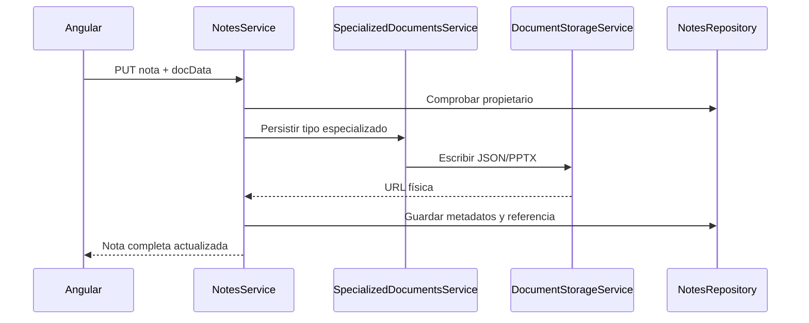

# 04 — Documentos y archivos

[Volver al índice](README.md)

## Responsabilidades

| Servicio | Función |
| --- | --- |
| `NotesService` | Identidad, propiedad, metadatos y coordinación. |
| `SpecializedDocumentsService` | Datos iniciales, conversión y ciclo de vida por tipo. |
| `DocumentStorageService` | Lectura/escritura/borrado físico mediante `fs.promises`. |

Los archivos se ubican en `uploads/documents/`, calculado respecto al directorio de ejecución:

| Tipo | Formato físico |
| --- | --- |
| `sheet`, `doc`, `canvas` | `<noteId>_<docType>.json` |
| `slide` | `<noteId>.pptx` binario |

Las rutas públicas correspondientes se guardan en `docUrl`. MongoDB mantiene la nota y los
bloques; para documentos especializados, el servicio conserva `docData` fuera de la base y
lo incorpora al responder lecturas completas.

## Flujo de guardado



Los PPTX se reciben como `{ format: 'pptx', base64 }`, se decodifican a bytes y se vuelven
a codificar para una lectura completa. Ese coste no debe ejecutarse para cada fila de la
navegación; la vista `summary` evita esas lecturas.

## API específica

`SpecializedDocumentsController` expone `GET` y `PUT /api/notes/:id/document`. Ambos comprueban
propiedad mediante el repositorio. El PUT recibe `docData`; la respuesta contiene identificador,
tipo, URL y datos especializados. Las actualizaciones habituales del frontend también pueden
usar `PUT /api/notes/:id`.

## Operación y Almacenamiento en la Nube (Cloudflare R2)

Para entornos sin estado o en la nube (como Koyeb, Render o Docker efímero), el backend soporta persistencia directa en **Cloudflare R2** mediante el cliente compatible con S3 (`@aws-sdk/client-s3`).

### Variables de entorno
```env
R2_ACCOUNT_ID="<account_id>"
R2_ACCESS_KEY_ID="<access_key>"
R2_SECRET_ACCESS_KEY="<secret_key>"
R2_BUCKET_NAME="<bucket_name>"
R2_ENDPOINT="https://<account_id>.r2.cloudflarestorage.com"
R2_PUBLIC_URL="https://<public_subdomain>.r2.dev"
```

Cuando estas variables están presentes:
1. `DocumentStorageService` escribe y lee directamente de Cloudflare R2 con fallback a disco/caché local.
2. `AssetsService` sube imágenes y archivos adjuntos a R2 con su tipo MIME correspondiente.
3. `UploadsFallbackController` redirige automáticamente (HTTP 302) peticiones de `/uploads/*` ausentes en disco local hacia la URL pública de R2.
4. El script `scripts/migrate-uploads-to-r2.mjs` permite sincronizar o migrar todo el directorio local `uploads/` al bucket de R2.

Respaldar MongoDB y `uploads/` (o el bucket de R2) juntos. La base sin archivos no basta para recuperar documentos especializados.
