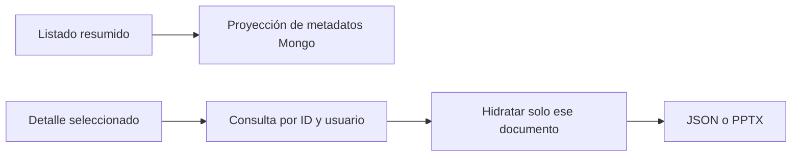

# 07 — Rendimiento, pruebas y operación

[Volver al índice](README.md)

## Carga inicial

Para navegar, Angular usa `GET /api/notes?view=summary`. La proyección evita bloques voluminosos
y `docData`, y el servicio no llama a `hydrateDocument`. Solo la nota seleccionada realiza la
lectura del archivo JSON/PPTX. El endpoint histórico sin `view=summary` mantiene su comportamiento
completo por compatibilidad y no es apropiado para un árbol de navegación grande.



No usar `Promise.all` sobre todos los archivos para acelerar el listado: aunque las lecturas
sean asíncronas, se siguen pagando disco, Base64, serialización y transferencia por cada nota.
La eliminación de ese trabajo es la optimización principal del servidor en el arranque.

## Verificación

```sh
npm test -- --runInBand
npm run build
```

La suite usa dobles de repositorios/proveedores. Incluye el puente IA, autenticación y notas;
las regresiones de resumen verifican que no se hidraten archivos y que la nota de bienvenida
no exponga contenido en esa vista. No usar una cantidad fija de tests como criterio de vigencia.

`npm run test:e2e` sigue apuntando a un scaffold que espera `Hello World!` en `/` y construye
`AppModule` con conexión Mongo. No representa actualmente una suite de producto lista para
validar documentos, archivos, permisos y rendimiento de extremo a extremo.

Para una comprobación integrada, usar una cuenta de prueba y verificar login, listado resumido,
detalle, edición, recarga y un documento de cada tipo. MongoDB, el volumen de archivos y FastAPI
deben probarse por separado de los dobles unitarios.

## Diagnóstico

| Síntoma | Comprobación |
| --- | --- |
| La web está blanca antes de llamar a la API | Bundle, fuentes y consola del frontend. |
| El listado tarda mucho o devuelve MB | Asegurar `view=summary`; inspeccionar proyección y respuesta. |
| Un único documento tarda | Tamaño del archivo, lectura de disco, conversión Base64 y motor del navegador. |
| 401 | JWT, expiración, secreto y usuario existente. |
| Documento especializado sin datos | Archivo físico, permisos y logs de `DocumentStorageService`. |
| Chat 400/502/503 | Registro del puente y [capítulo 06](06-PUENTE-DE-IA.md). |

La optimización del frontend y sus métricas se documentan en
[rendimiento de Angular](../../frontend/guia-desarrollador/07-RENDIMIENTO-Y-PRUEBAS.md).
No atribuir el tiempo de compilación del dev server al tiempo de una consulta Mongo.

## Despliegue

Compilar antes de ejecutar `npm run start:prod`. Conservar `.env` fuera del repositorio, un
volumen durable para `uploads/`, respaldo Mongo y conectividad interna a FastAPI. El frontend
necesita fallback SPA y un proxy correcto para `/api` y `/uploads` cuando se sirve desde otro
proceso. La política actual de archivos públicos y CORS está descrita en el capítulo 02.
