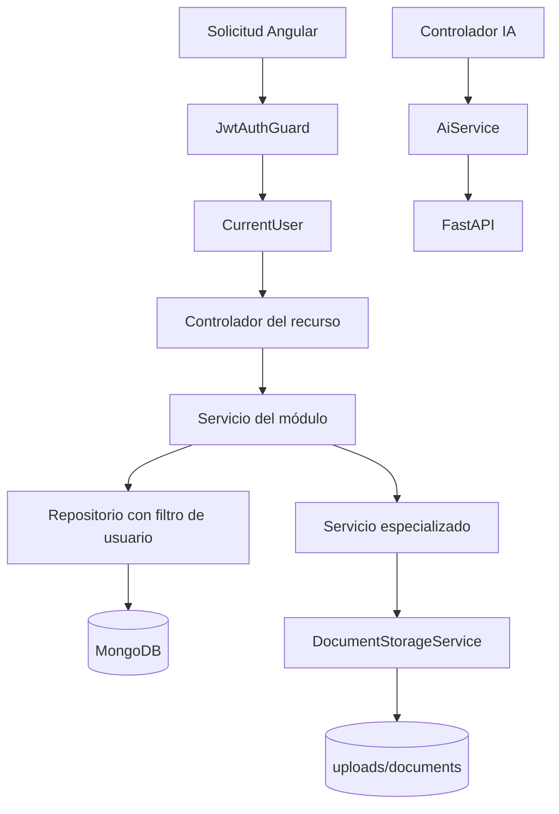

# 08 — Mapa de directorios y flujos

[Volver al índice](README.md)

| Ruta desde `backend/` | Responsabilidad |
| --- | --- |
| `src/main.ts` | Arranque HTTP, body parsers, CORS y validación. |
| `src/app.module.ts` | Composición de módulos, configuración, Mongo y estáticos. |
| `src/common/decorators/` | Acceso a identidad de la petición. |
| `src/common/guards/`, `strategies/` | Guard JWT y validación de sesión. |
| `src/modules/auth/` | DTOs, usuario, repositorio, autenticación y perfil. |
| `src/modules/notes/controllers/` | Documentos, bloques y datos especializados. |
| `src/modules/notes/services/notes.service.ts` | Coordinación y API de notas. |
| `src/modules/notes/services/note-blocks.service.ts` | Reglas de bloques. |
| `src/modules/notes/services/specialized-documents.service.ts` | Adaptación por formato. |
| `src/modules/notes/services/document-storage.service.ts` | Disco local y formatos físicos. |
| `src/modules/notes/repositories/`, `entities/` | Consultas Mongo y esquema de notas/bloques. |
| `src/modules/spaces/` | Árbol, rutas, movimiento y persistencia de directorios. |
| `src/modules/assets/` | Subida y metadatos de archivos. |
| `src/modules/ai/` | Puente JWT/HTTP a FastAPI. |
| `uploads/` | Archivos locales; respaldar y montar como volumen. |
| `test/` | Configuración y scaffold de integración. |
| `guia-desarrollador/` | Arquitectura, contratos y operación. |

## Dónde agregar un cambio

| Necesidad | Lugar |
| --- | --- |
| Campo persistido | Entidad, DTO, repositorio y consumidor Angular coordinados. |
| Regla de edición de bloques | `NoteBlocksService`, sin duplicarla en controladores. |
| Nuevo formato especializado | `SpecializedDocumentsService` y almacenamiento/consumidor correspondiente. |
| Otra forma de almacenamiento | Adaptación de `DocumentStorageService`; revisar persistencia de metadatos y respaldo. |
| Nuevo modelo de IA | FastAPI; NestJS solo cambia si cambia el contrato del puente. |
| Listado más eficiente | Proyección en repositorio y contrato de vista resumida, sin hidratar archivos. |

`IDocumentStorageService` describe el contrato, pero la inyección actual usa la clase concreta;
no asumir que existe un token de proveedor intercambiable ya configurado. Las reglas de negocio
no deben depender de componentes Angular ni del formato de un SDK cloud.
